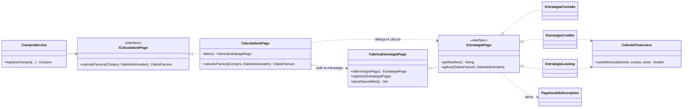

# Concesionario

## Descripción y objetivo

El proyecto **Concesionario** es un sistema desarrollado en Java, diseñado para centralizar y administrar de manera eficiente las operaciones principales de un concesionario de vehículos. La aplicación permite gestionar la información de clientes, asesores y catálogo de vehículos con existencias, así como realizar los procesos de preventa, venta y generación de facturas.

El objetivo principal es construir una plataforma robusta y mantenible aplicando buenas prácticas de desarrollo, arquitectura por capas y patrones de diseño de software a lo largo de la asignatura.

## Problema que busca resolver

Un concesionario que lleva el registro de clientes, ventas y preventas de forma manual tiene dificultades para saber qué vehículos hay disponibles, qué asesor atiende a cada cliente y cuánto debe pagar el cliente según la modalidad de pago. El sistema centraliza esa información y automatiza el cálculo de la factura.

## Alcance

El alcance actual abarca la gestión de datos maestros y transacciones comerciales de un concesionario vehicular. Permite la administración en memoria de usuarios (clientes y asesores), el inventario de autos y el flujo comercial completo, desde la asignación de preventa hasta la emisión final de la factura de venta.

No incluye todavía persistencia en base de datos, autenticación de usuarios ni reportes exportables.

## Funcionalidades implementadas

- **Gestión de clientes y asesores:** registro y consulta de la información básica de los usuarios, con asignación automática de asesor.
- **Catálogo de vehículos:** control de inventario con detalle de existencias, mostrado en una tabla (marca, modelo, precio, país y cantidad).
- **Gestión de preventas y ventas:** registro de preventas (con el vehículo actual y el vehículo deseado del cliente) y formalización de la venta.
- **Compras con tres formas de pago:** contado, crédito y leasing, con cálculo de cuotas con interés.
- **Facturación:** soporte de facturación derivado de las ventas, con el plan de financiación cuando aplica y el número de compra real en la factura.
- **Búsquedas:** clientes por ID, asesores por nombre, vehículos por modelo (y por marca en el servicio) y compras por número, desde el botón *BUSCAR* del menú.
- **Control de inventario y desempeño:** al concretar la compra se descuenta la existencia del vehículo, se registra la venta del asesor y el cliente queda asociado al vehículo comprado (estado COMPRA).
- **Validaciones y manejo de errores:** cuotas mayores que cero, entidad financiera obligatoria en leasing, cuota inicial válida, inventario disponible y mensajes claros al usuario mediante `PagoInvalidoException`.
- **Pruebas automatizadas:** 31 casos con JUnit 4 sobre las estrategias de pago, la fábrica, el servicio de compras y las búsquedas.

## Tecnologías utilizadas

- **Lenguaje de programación:** Java (JDK 21 o superior)
- **Interfaz gráfica:** Swing
- **IDE:** Apache NetBeans / Visual Studio Code
- **Gestor de construcción:** Apache Ant (`build.xml`, proyecto de NetBeans)
- **Pruebas:** JUnit 4
- **Control de versiones:** Git y GitHub

## Estructura actual del proyecto

```
Concesionario/
├── README.md
├── .gitignore
├── build.xml, manifest.mf, nbproject/     # configuración NetBeans / Ant
├── src/
│   ├── concesionarioo/    # Main (punto de entrada) y modelos: Persona, Cliente, Asesor, Vehiculo, Compra
│   ├── Repositorio/       # Interfaces y repositorios en memoria
│   ├── Servicio/          # Lógica de negocio: CompraService, CalculadoraPago, notificaciones...
│   ├── Pagos/             # Patrón Strategy + Factory (formas de pago)
│   └── Swing/             # Interfaz gráfica (menú, registros, preventa, pago y catálogo)
├── tests/
│   ├── README.md
│   ├── Pagos/             # Pruebas de estrategias y fábrica
│   └── Servicio/          # Pruebas de CompraService y ConcesionarioService (compras y búsquedas)
└── docs/
    ├── descripcion_proyecto.md
    ├── patrones/strategy_factory.md
    └── diagramas/strategy_pago.png (.mmd)
```

## Patrones y decisiones de construcción

El proyecto aplica un patrón principal, implementado en esta entrega, y varios patrones de arquitectura presentes en la base del código.

### Patrones de diseño implementados

#### 1. Strategy (patrón principal)
- **Problema:** el cálculo del pago dependía de `switch` por tipo (contado, crédito, leasing) repetidos en la calculadora y en la interfaz, y existían dos jerarquías duplicadas con reglas distintas.
- **Justificación:** las formas de pago comparten un objetivo (completar la factura) pero con reglas diferentes, y pueden aparecer nuevas.
- **Aplicación:** cada forma de pago es una estrategia intercambiable que valida sus datos y calcula su parte de la factura.
- **Componentes:** `EstrategiaPago` (interfaz), `EstrategiaContado`, `EstrategiaCredito`, `EstrategiaLeasing`, `CalculadoraPago` (contexto) y `CalculoFinanciero` (fórmula compartida).
- **Beneficios:** sin `switch`, código duplicado eliminado, nuevas formas de pago sin modificar las existentes y pruebas por estrategia.

#### 2. Factory (fábrica simple con registro)
- **Problema:** la interfaz entrega un texto ("CRÉDITO", "Leasing") y alguien debe traducirlo a la estrategia correcta.
- **Aplicación:** `FabricaEstrategiaPago` normaliza el texto (tildes y mayúsculas), devuelve la estrategia y permite registrar nuevas con `registrar(...)`. Un tipo desconocido lanza `PagoInvalidoException`.
- **Beneficio:** la decisión de qué estrategia usar queda en un solo lugar.

### Patrones de arquitectura presentes en el código

| Patrón / principio | Dónde se ve | Para qué sirve |
|---|---|---|
| **Repository** | `Repositorio/` (`iRepoCliente`, `iRepoVehiculo`, `iRepoCompra`, `iRepoAsesor` y sus implementaciones en memoria) | Separa el acceso a los datos de la lógica de negocio; permite cambiar la memoria por una base de datos sin tocar los servicios |
| **Service Layer** | `Servicio/` (`ClientService`, `VehiculoService`, `CompraService`) | Concentra las reglas de negocio fuera de la interfaz gráfica |
| **Facade** | `ConcesionarioService` | Ofrece a la interfaz Swing un único punto de acceso a clientes, vehículos, asesores, compras, búsquedas y reportes |
| **Inyección de dependencias** | Constructores de `CompraService`, `ClientService` y `ConcesionarioService`; se ensamblan en `Main` | Las clases dependen de interfaces, no de implementaciones concretas, lo que facilita las pruebas |
| **Abstracción por interfaz** | `iServicioNotificacion` / `ServicioNotificacionSwing` | La lógica de negocio no depende de Swing; se puede cambiar la forma de notificar |
| **Segregación de interfaces** | `iBuscablePorId`, `iEliminable`, `iActualizable`, `iRepositorioBase<T>` | Interfaces pequeñas y genéricas que cada repositorio combina según lo que necesita |
| **DTO (objeto de transferencia)** | `DatosFactura`, `DatosAdicionales` | Transportan los datos de la factura y los datos opcionales del pago entre capas |
| **Herencia y polimorfismo** | `Persona` → `Cliente`, `Asesor` | Reutiliza atributos comunes de las personas |

### Otras decisiones de construcción
- **Separación de responsabilidades:** la interfaz (`PagoForm`) solo captura datos; el cálculo vive en las estrategias y las reglas de la compra en `CompraService`.
- **Código duplicado eliminado:** se retiró la jerarquía `Pago`, `PagoContado`, `PagoCredito`, `PagoLeasing` y `RegistroPago`.
- **Manejo de errores:** `PagoInvalidoException` para formas de pago o datos inválidos; validación de inventario antes de vender.
- **Integridad de la compra:** la compra se guarda, descuenta inventario y asocia el vehículo al cliente solo si el cálculo del pago fue válido.
- **Identificadores reales:** el número de compra es secuencial y único, y es el mismo que aparece en la factura (no se generan números aleatorios).

Documentación detallada del patrón, con diagrama de clases y ejemplo de extensión: [`docs/patrones/strategy_factory.md`](docs/patrones/strategy_factory.md)



## Metodología y prácticas de desarrollo

- **Desarrollo incremental:** el proyecto se construye por entregas. La primera dejó la estructura y la documentación; la segunda incorpora el patrón Strategy + Factory, las búsquedas, el control de inventario, validaciones y pruebas.
- **Control de versiones con Git:** trabajo sobre un único repositorio en GitHub, con historial que muestra la evolución del proyecto.
- **Commits convencionales:** mensajes con prefijo según el tipo de cambio: `feat` (funcionalidad), `refactor` (reorganización sin cambiar el comportamiento), `test` (pruebas) y `docs` (documentación).
- **Refactorización guiada por patrones:** se identificó el código duplicado y los `switch` por tipo de pago, y se reemplazaron por el patrón Strategy sin cambiar lo que ve el usuario.
- **Pruebas automatizadas:** se verifican por separado cada estrategia, la fábrica, el flujo de compra y las búsquedas, incluyendo los casos de error.
- **Arquitectura por capas:** interfaz (`Swing`), servicios (`Servicio`), acceso a datos (`Repositorio`) y modelos (`concesionarioo`), cada una con una responsabilidad.
- **Organización del equipo:** <<describan aquí cómo se reparten el trabajo: por módulos, por funcionalidades, quién revisa, cómo se comunican>>.

## Instrucciones de ejecución

**Con NetBeans (recomendado)**
1. Clonar: `git clone https://github.com/gabii-opss/Concesionario.git`
2. `File > Open Project` y seleccionar la carpeta del repositorio.
3. Clic derecho en el proyecto > `Run` (clase principal: `concesionarioo.Main`).

**Por línea de comandos (JDK 21 o superior)**

En Windows (PowerShell):
```powershell
mkdir out
javac -encoding UTF-8 -d out (Get-ChildItem -Recurse src -Filter *.java).FullName
java -cp out concesionarioo.Main
```

En Linux o macOS:
```bash
mkdir -p out
javac -encoding UTF-8 -d out $(find src -name "*.java")
java -cp out concesionarioo.Main
```

**Ejecutar las pruebas**

En NetBeans: clic derecho en *Test Libraries* > *Add Library* > **JUnit 4.x**, luego clic derecho en el proyecto > **Test** (Alt+F6). Más detalle en [`tests/README.md`](tests/README.md).

## Integrantes del equipo

| Nombre | Usuario GitHub |
|---|---|
| <<Nombre integrante 1>> | <<@usuario>> |
| <<Nombre integrante 2>> | <<@usuario>> |
| <<Nombre integrante 3>> | <<@usuario>> |

## Estado actual del proyecto

Segunda entrega: núcleo funcional completo (clientes, asesores, catálogo, preventas, compras con tres formas de pago y búsquedas), patrón Strategy + Factory implementado, control de inventario, validaciones, manejo de errores y pruebas automatizadas.

## Próximos avances

- Persistencia (base de datos o archivos) para clientes, compras e inventario.
- Patrón **Observer** para las notificaciones.
- Búsqueda por varios criterios a la vez (marca, rango de precio) con listado de resultados, no solo el primero.
- Reportes exportables (PDF/CSV) y recuperar el reporte de clientes en preventa en el menú.
