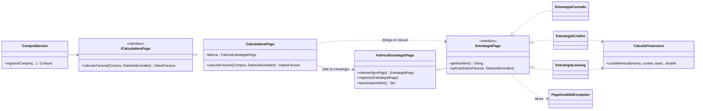

# Patrón Strategy + Factory: formas de pago

## 1. Nombre del patrón
- **Strategy** (comportamiento): cada forma de pago es una estrategia intercambiable.
- **Factory** (creación, fábrica simple con registro): elige la estrategia según el texto que llega de la interfaz.

## 2. Problema que busca solucionar
Antes de esta entrega el cálculo de los pagos estaba resuelto con `switch` por tipo de pago y con lógica repetida:

| Problema | Dónde estaba |
|---|---|
| `switch` por tipo de pago en la calculadora | `CalculadoraPago.calcularFactura` |
| Otro `switch` equivalente en la interfaz | `PagoForm.procesarPago` |
| Dos jerarquías paralelas que hacían lo mismo (`Pagos/Pago*` y `CalculadoraPago`) con reglas **distintas** (crédito sin interés en una y 2 % mensual en la otra) | `Pagos/` y `Servicio/` |
| Un tipo de pago desconocido se trataba en silencio como CONTADO | `default:` del `switch` |
| Cada forma de pago nueva obligaba a tocar varias clases (violación del principio abierto/cerrado) | todas las anteriores |

## 3. Justificación de la selección
- El dominio del proyecto (concesionario) tiene varias **formas de pago** que comparten un mismo objetivo (completar la factura) pero con reglas distintas: es el escenario típico de Strategy.
- Es muy probable que aparezcan nuevas formas de pago (renting, subsidio, permuta...). Con Strategy se agregan sin modificar código existente.
- Se añade una fábrica porque la interfaz entrega un `String` ("CRÉDITO", "Leasing"...) y alguien debe traducirlo a la estrategia; así esa decisión queda en **un solo lugar**.

## 4. Descripción de su aplicación
1. `PagoForm` pide al usuario los datos y llama a `ConcesionarioService.registrarCompra(...)`.
2. `CompraService` valida (cliente, vehículo, asesor, inventario) y pide la factura a `iCalculadoraPago`.
3. `CalculadoraPago` (el *contexto*) obtiene la estrategia con `FabricaEstrategiaPago.obtener(tipoPago)`.
4. La estrategia valida los datos adicionales y completa `DatosFactura` (`aplicar`).
5. Solo si no hubo errores, `CompraService` guarda la compra, descuenta inventario y notifica.

```java
// CalculadoraPago.java: ya no hay switch
EstrategiaPago estrategia = fabrica.obtener(compra.getTipoPago());
DatosFactura factura = crearFacturaBase(compra, estrategia.getNombre());
estrategia.aplicar(factura, datos);
```

## 5. Componentes involucrados
| Clase | Rol en el patrón | Responsabilidad |
|---|---|---|
| `EstrategiaPago` | Strategy (interfaz) | Contrato: `getNombre()` y `aplicar(factura, datos)` |
| `EstrategiaContado` | Estrategia concreta | Sin financiación |
| `EstrategiaCredito` | Estrategia concreta | Cuota fija con 2 % mensual (12 cuotas por defecto) |
| `EstrategiaLeasing` | Estrategia concreta | Exige entidad; cuota inicial 10 % por defecto o la indicada; 36 cuotas por defecto |
| `FabricaEstrategiaPago` | Factory | Normaliza el texto (tildes, mayúsculas) y devuelve la estrategia; permite `registrar(...)` nuevas |
| `CalculadoraPago` | Context | Arma la factura base y delega en la estrategia |
| `CalculoFinanciero` | Utilidad | Fórmula de cuota mensual compartida (evita duplicarla) |
| `PagoInvalidoException` | Manejo de errores | Forma de pago inexistente o datos inválidos |

Diagrama: [`docs/diagramas/strategy_pago.png`](../diagramas/strategy_pago.png) (fuente editable en `strategy_pago.mmd`).



## 6. Código correspondiente
Paquete `src/Pagos/` (`Estrategia*.java`, `FabricaEstrategiaPago.java`, `CalculoFinanciero.java`) y `src/Servicio/CalculadoraPago.java`.

### Cómo agregar una nueva forma de pago (ejemplo)
```java
public class EstrategiaRenting implements EstrategiaPago {
    public String getNombre() { return "RENTING"; }
    public void aplicar(DatosFactura factura, DatosAdicionales datos) { /* reglas propias */ }
}
// y una línea en el constructor de FabricaEstrategiaPago:
registrar(new EstrategiaRenting());
```
No se modifica `CalculadoraPago`, `CompraService` ni las demás estrategias.

## 7. Beneficios obtenidos
- **Eliminados los `switch`** por tipo de pago en la calculadora y la lógica de cálculo en la interfaz.
- **Una sola fuente de verdad**: se eliminó la jerarquía duplicada `Pago/PagoContado/PagoCredito/PagoLeasing/RegistroPago` y se unificó la regla de interés.
- **Abierto a extensión, cerrado a modificación**: nuevas formas de pago sin tocar código existente.
- **Cada estrategia se prueba por separado** (ver `test/Pagos/`).
- **Errores explícitos**: un tipo desconocido o datos inválidos lanzan `PagoInvalidoException` y no se guarda la compra ni se descuenta inventario.
- Corrección de un error previo: el leasing ignoraba la cuota inicial que digitaba el usuario y usaba siempre el 10 %.
